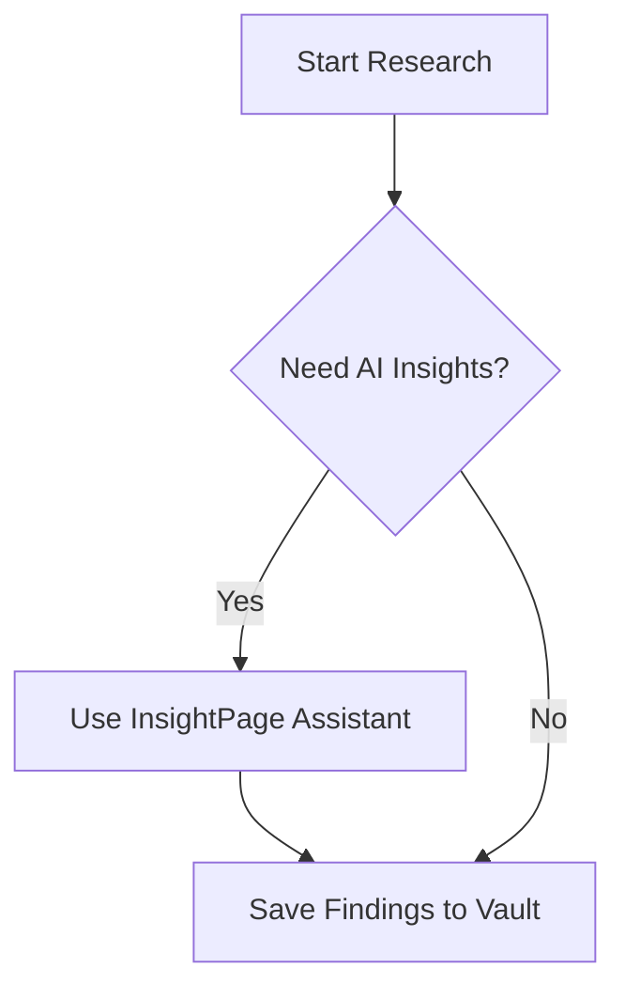
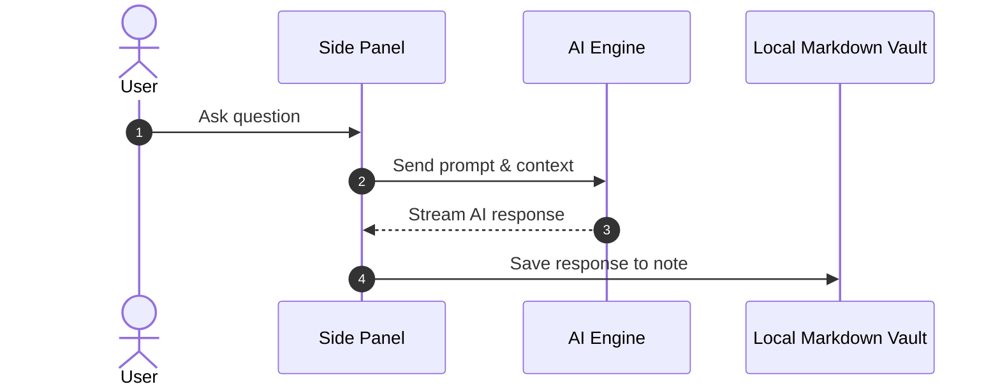
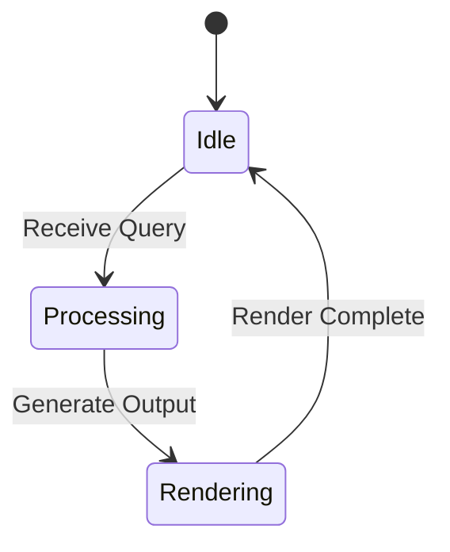
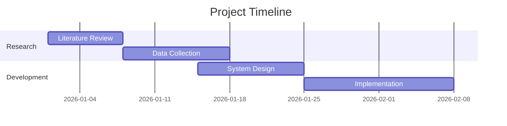
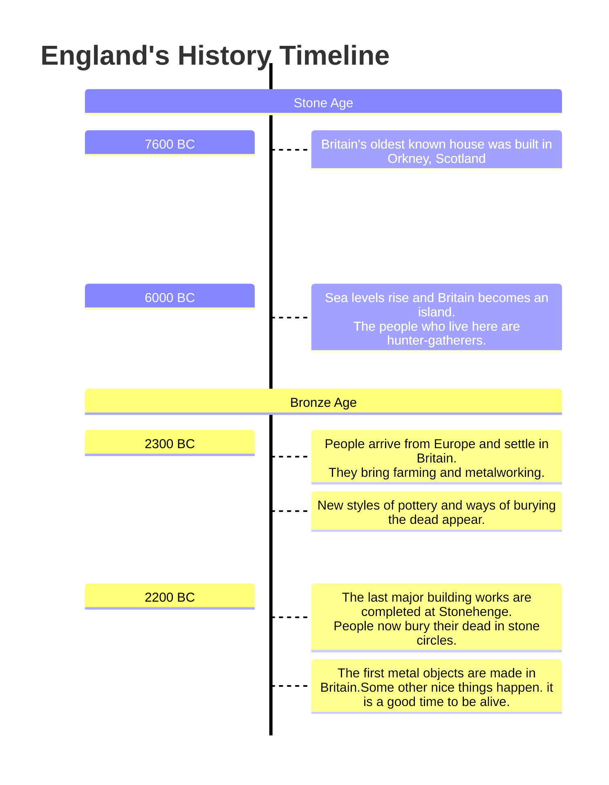

InsightPage supports rendering vector diagrams directly in your notes using **Mermaid**.

---

## Supported Diagram Types

The following standard Mermaid diagram types are fully supported:
- **Flowcharts** (`graph` / `flowchart`)
- **Sequence Diagrams** (`sequenceDiagram`)
- **Class Diagrams** (`classDiagram`)
- **State Diagrams** (`stateDiagram-v2`)
- **Entity Relationship Diagrams** (`erDiagram`)
- **Gantt Charts** (`gantt`)
- **Git Graphs** (`gitGraph`)

> [!Note] Omitted Diagram Types & Superior Alternatives
> Heavy specialized Mermaid chart modules (`xychart`, `pie`, `journey`, `architecture`, `mindmap`) are intentionally omitted to keep extension bundle size lightweight and eliminate CPU rendering spikes:
> - **For charts & graphs:** Use **Chart.js style syntaxes** (`chart` code block) or **Observable Plot** (`plot` or `cosyobservableplot` code block). They provide far superior visual rendering, crisp SVG vector scaling, rich interactivity, and responsive layout compared to Mermaid's static chart output. See: 👉 **[[Example Chart]]**.
> - **For mindmaps:** Use the built-in interactive **Mindmap Viewer** (powered by Markmap) for a smooth, zoomable, and collapsible mind-mapping experience.

---

## Flowchart Example



---

## Sequence Diagram Example



---

## State Diagram Example



---

## Gantt Chart Example



## Timeline



```timeline
 [{start: "2022-03-01", end: Date.now(), test: "a", institution: "Aarhus University", title: "Postdoctoral Researcher", type: "academia", collection: ["mapblender"]},
  {start: "2019-03-01", end: "2022-02-26", test: "a", institution: "Aarhus University", title: "Ph.D. Student", type: "academia", collection: ["ProSample", "ProSteer", "ReVize", "ReVis", "ReData", "ColorBrewer-lite", "VisFlow-lite"]},
  {start: "2016-10-01", end: "2019-01-31", test: "b", institution: "Technical University Dresden", title: "MSc. Student in Computer Science", type: "education", collection: ["Glyphboard", "Conversation Trainer", "VisBlocks"]},
  {start: "2013-10-01", end: "2016-09-30", test: "a", institution: "Technical University Dresden", title: "BSc. Student in Computer Science", type: "education", collection: []},
  {start: "2021-01-01", end: "2021-04-30", test: "b", institution: "Carnegie Mellon University", title: "Visiting Ph.D. student at DIG Lab", type: "academia", collection: ["ProInterest"]},
  {start: "2016-10-02", end: "2018-03-30", test: "a", institution: "Technical University Dresden", title: "Web developer", type: "academia", collection: []},
  {start: "2017-09-01", end: "2019-01-31", test: "a", institution: "SAP", title: "Part-time developer", type: "industry", collection: ["Parallel Hierarchies"]}]
```

```timeline
- start: 2022-03-01
  end: 2024-01-01
  institution: Aarhus University
  title: Postdoctoral Researcher
  type: academia
  test: a
  collection: [mapblender]

- start: 2019-03-01
  end: 2022-02-26
  institution: Aarhus University
  title: Ph.D. Student
  type: academia
  test: a
  collection: [ProSample, ProSteer, ReVize, ReVis, ReData, ColorBrewer-lite, VisFlow-lite]

- start: 2016-10-01
  end: 2019-01-31
  institution: Technical University Dresden
  title: MSc. Student in Computer Science
  type: education
  test: b
  collection: [Glyphboard, Conversation Trainer, VisBlocks]

- start: 2017-09-01
  end: 2019-01-31
  institution: SAP
  title: Part-time developer
  type: industry
  test: a
  collection: [Parallel Hierarchies]
```
