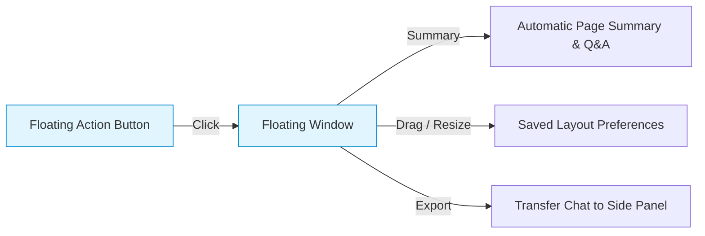
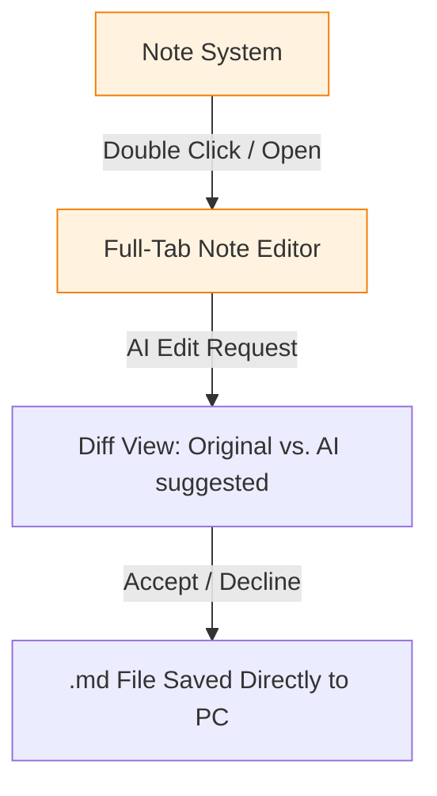

# InsightPage Assistant: Key Features

InsightPage integrates an AI chat engine, an interactive floating assistant, a local markdown vault, and smart web clipping into a unified research and knowledge management workflow.

---

## 1. AI Chat Engine

InsightPage's side panel features a flexible, powerful chat interface that connects directly to local or cloud-based AI models.

### Chat Modes
* **Standard Chat Mode (`chat`)**: Converse with the AI using general knowledge and conversation history.
* **Web Mode (`web`)**: The AI optimizes your query, performs a live web search, visits top relevant pages to extract content, and synthesizes a fully-sourced, up-to-date answer.
* **Page Mode (`page`)**: The AI reads the active browser tab's content (including web PDFs) to summarize, extract structured data, or answer questions in context.

### Hybrid RAG Search
Type `/r` before a query (e.g. `/r key takeaways from project alpha`) to run a **Hybrid Search** across your notes:
* **Keyword Search (BM25)**: Matches exact keywords in notes and chats.
* **Semantic Search (Embeddings)**: Matches the underlying conceptual meaning.
* **MMR Reranking**: Re-ranks results to maximize relevance while minimizing redundancy before feeding context to the LLM.

### Smart Dispatcher
When given multi-step requests, the `smart_dispatcher` acts as your personal AI agent:
1. Searches the web.
2. Extracts full article text.
3. Synthesizes structured summaries.
4. Saves findings directly to your Note Viewer vault.

---

## 2. Floating Assistant

The **Floating Assistant** brings AI assistance directly onto any webpage, letting you interact with content seamlessly without opening the full side panel.

* **Floating Action Button (FAB)**: A lightweight button floating at the edge of the viewport. Drag vertically to reposition anytime.
* **Floating Window**: Movable, resizable overlay window.
* **In-Context Actions**:
  * **Automatic Summaries**: Instant page overview, detected tags, and suggested follow-up questions.
  * **In-Context Chat**: Ask questions directly about the page content.
  * **Quick Transfers**: Clear chat with **Refresh**, or migrate the conversation to the main side panel with **Open in Side Panel**.

---

## 3. Note Viewer & Personal Vault

The note-taking system serves as your second brain, offering full Markdown compatibility and native local-file integration.

* **Local Markdown Vault**: Connect folders on your PC directly using the **File System Access API**. Notes are saved as standard `.md` files in real-time, functioning as a lightweight Obsidian-like setup. No intermediate cache layer is used, preventing write amplification and keeping your local directory as the single source of truth.
* **Obsidian Style & Rich Visualization Ecosystem**:
  * InsightPage's rendering capabilities are powered by the official Obsidian community plugin [**`3-ark/insightpage-style`**](https://github.com/3-ark/insightpage-style). Use the plugin in Obsidian to get the exact same charts, maps, timelines, ABC sheet music audio player, and inline popover comments in your desktop Obsidian vault.
* **Wikilinks & Deep Internal Linking (`[[Note Title]]`)**:
  * Full Wikilink syntax support across notes, popovers, and chat responses.
  * Type `[[Note Title]]` to link to any note in your vault. Clicking a Wikilink navigates directly or creates the note if it does not exist yet.
* **Note Mentions (`@[Note Title]`) & Context Injection**:
  * Type `@` in the chat input to search and attach specific notes directly into the AI context window.
* **Select Notes for Q&A**:
  * Select multiple notes from your Vault list and click **Start Q&A** to pre-fill note mentions (`@[Note Title]`) in the chat bar. The AI will answer queries using strictly the selected notes.
* **Full-Page Tab Editor**: Open any note in a new browser tab for a spacious, distraction-free editing layout complete with adjustable font sizes.
* **AI-Powered Note Editing & Diff View**:
  1. Open your note in a new tab.
  2. In the side panel, ask the AI to modify the note (e.g., *"Make this summary more concise"*, *"Translate to German"*).
  3. View the real-time **Diff View** in your note tab, highlighting additions and deletions side-by-side.
  4. Click **Accept** to commit the changes directly to your file, or **Decline** to keep the original.

Explore all visual rendering features in our [Rendering Showcase]({{ '/Rendering Showcase/' | relative_url }}).

---

## 4. Context Window & Smart Clipping

* **Context Window Integration**: Drag files, images, or enter specific URLs into the chat's input context window. URLs are automatically scraped and used as additional prompt context.
* **Smart Web Clipper**:
  * Highlight any text on a webpage, right-click, and select **Add to Note** to append the text to your current popover note.
  * Use the context menus to quickly capture insights without breaking your browsing momentum.
* **Smart Weekly Notes**:
  * Instantly create or open weekly review files with predefined action templates.
  * Highlight text on any page, right-click, and select **Add to Weekly Note** to instantly append clean, sanitized web links (stripping analytical and tracking parameters) alongside your captured snippets.
  * Customize action items and path folders under **Settings -> Page Mode Settings**.

---

## 5. Advanced & Multi-Modal Capabilities

### Multimodal Image & Vision Model Support
* **Vision-Ready Uploads**: Upload standard image formats (`.png`, `.jpg`, `.jpeg`, `.webp`, `.gif`) via the chat input interface.
* **Automatic Resolution & Quality Optimization**: Large images (longer side > 1568px) are automatically scaled down while maintaining aspect ratio. Large PNG images are automatically optimized to JPEG (90% quality with white background fallbacks) before dispatch to avoid API limits.
* **Native Vision Payloads**: Images are sent as structured, OpenAI-compatible `image_url` vision payloads, compatible with cloud endpoints (GPT-4o) and local multi-modal hosts (LM Studio).

### Intelligent PDF Operations & Language Auto-Detection
* **Dynamic Language Detection**: Automatically detects language families—including English, Spanish, German, French, Simplified Chinese (`zh-CN`), Traditional Chinese (`zh-TW`), Japanese, and Korean.
* **One-Click PDF Generation**: The note action menu features a direct PDF download button that automatically selects appropriate system fonts and runs high-performance regex checks for CJK rendering based on text content.
* **Background PDF Text Extraction**: Web PDF tab text parsing is handled asynchronously in background service workers and offscreen documents, preventing UI freezes and bundle bloat.

### Theme-Aware Design & Floating Window Polish
* **Unified Custom Theme Palette Mapping**: When using themes like Moss, Night Sepia, or Dark, all dropdown selectors, settings panels, hover menus, and modals adapt seamlessly.
* **Theme-Aware Floating Tooltips**: Tooltips leverage CSS variables (`--tooltip-bg`, `--tooltip-fg`, and `--tooltip-border`) to match the active persona theme.
* **Hover-Triggered Action Overlays**: Quick-action controls (such as web search toggles) transition smoothly on container hover or input focus.

---

## 6. Privacy, Security & Data Ownership

* **100% Local-First Architecture**: No developer servers, no proxies, no user registration, and no tracking.
* **Direct Client-to-API Communication**: Browser talks directly to your configured AI provider or local server.
* Learn more on our [Privacy & Security Policy]({{ '/privacy-policy/' | relative_url }}).
