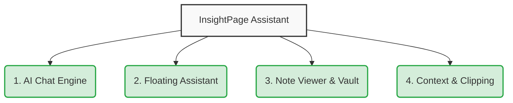
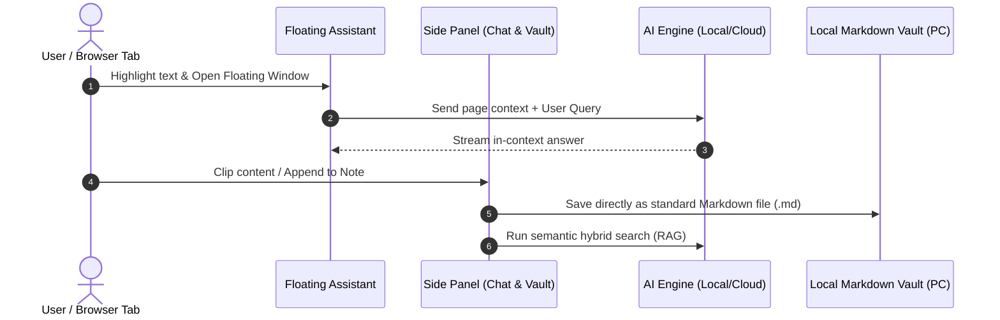

# InsightPage Assistant: Getting Started

Welcome to **InsightPage**! InsightPage is an open, privacy-first Personal Knowledge Management (PKM) browser extension with integrated AI assistance, helping you turn web browsing, research, and note-taking into a seamless workflow.

---

## System Overview & Information Flow

Below are architectural diagrams illustrating how InsightPage organizes its functionalities into four core pillars and how data flows between your browser, the AI engine, and your local files.

### The Four Core Pillars of InsightPage

### Information Flow Diagram

---

## 🚀 Quick Setup & Configuration

InsightPage is designed to be highly configurable and operates under a **Bring Your Own Key (BYOK)** model. Access settings anytime by clicking your persona's avatar in the top-left corner of the side panel.

1. **API & Model Access**:
   - **Cloud Providers**: Direct support for OpenAI, Google Gemini, Groq, OpenRouter, and custom OpenAI-compatible endpoints.
   - **Local Inference**: Connect zero-cost local LLMs via Ollama (`http://localhost:11434/v1`) or LM Studio (`http://localhost:1234/v1`).
   - All keys and endpoints are stored purely within your local browser storage.
2. **Local Markdown Vault Setup**:
   - Open the **Note System** tab.
   - Click **Connect Folder** and pick any local folder on your computer using the Web File System Access API.
   - Notes are immediately written directly to disk as `.md` files without intermediate proprietary cloud servers.
3. **AI Personas & Prompt Customization**:
   - Customize personality prompts (Research, Business, Concise Explainer, Code Assistant) and upload custom persona avatars.
4. **Themes & UI Customization**:
   - Switch between built-in themes (Paper, Night Sepia, Moss, Light, Dark) or create your own custom color scheme.

---

## 🛠️ Common Troubleshooting & Quick-Fixes

* **AI fails to respond**: Verify your internet connection for cloud models, or ensure your local Ollama/LM Studio server is running on the correct port (e.g., `http://localhost:11434/v1`).
* **RAG Search returns empty results**: If in **Manual Mode**, remember to open Embedding Management in the main menu and click **Rebuild** or **Update** to index your notes and chats.
* **File System directory disconnects**: Browsers require user permission to access local folders after a browser restart. Go to the Note System and click "Reconnect" or select your folder again to restore access.

---

## 📚 Further Reading

* [Explore Detailed Features & Capabilities]({{ '/docs/insightpage/features/' | relative_url }})
* [Interactive Rendering Showcase]({{ '/Rendering Showcase/' | relative_url }})
* [Privacy Policy & Local-First Principles]({{ '/privacy-policy/' | relative_url }})
* [Documentation Hub Home]({{ '/docs/' | relative_url }})
